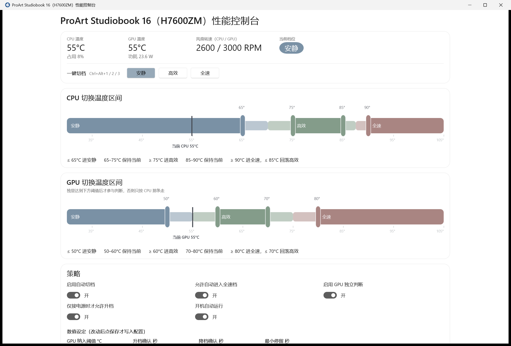

# ProArt Studiobook 16（H7600ZM）性能控制台

一个替掉 **ProArt Creator Hub + 华硕管家（MyASUS）** 的风扇档位控制台：按 CPU / GPU 温度自动在 安静 / 高效 / 全速 三档之间切换，阈值全部可拖拽自定义。

免管理员、无驱动、无第三方运行时依赖（.NET 10 + Windows App SDK 自包含分发）。



## 为什么没有风扇曲线

这台机器（H7600ZM，i7-12700H + RTX 3060 Laptop）的 EC 里**根本没有逐风扇 PWM / 曲线写入口**，BIOS 也没有。逐通道实测（`tools/ecprobe`）：

| 通道 | 结论 |
| --- | --- |
| `\\.\ATKACPI` → `0x00110013 / 14 / 19` | 可读 CPU/GPU 风扇转速、可读写档位（唯一可用的写入口） |
| 曲线 `0x00110024 / 0x00110025 / 0x00110032` | EC 不应答（`ERROR_INVALID_FUNCTION`，即表里不存在） |
| 迟滞 `0x00110034`、NewFanStatus `0x00110035` | 同上，含 1024 字节缓冲读也失败 |
| `AsusWinIO64.dll` + `AsusSAIO.sys` | 通道活着但被内部 "BatteryHealthyTable version" 门槛挡死，风扇 API 全返回哨兵值 |
| Creator Hub 的 Laptop 模块 | 反编译可见 `LoadFanCurve/SaveFanCurve` 与 8 点曲线 UI，但被 `MachineYear < 2025` 门控，且 RPC 枚举里只有读、没有任何写曲线的方法 |

所以能做、也是这个项目做的，就是**三档之间的自动切换 + 非对称进出阈值 + 临时全速定时**——把官方软件里那套"只有三个按钮"的东西变得可控。

## 功能

- **两条独立的区间编辑器**（CPU / GPU 各一条）：安静进入、安静退出、全速退出、全速进入四个把手，进出阈值分开，中间是"保持当前"的死区。
- **升降档防抖**：升档需条件持续 N 秒（默认 3s），降档需持续 M 秒（默认 15s），另有最小停留秒；相邻阈值强制 ≥1°C 间距，否则死区宽度为 0 会让档位在阈值上反复横跳。
- **GPU 参与条件**：独显温度达到"纳入阈值"（默认 60°C）才参与取 max，凉了或休眠时完全按 CPU 那条走，界面显示"GPU 休眠"而不是 0 RPM。
- **临时全速**：可定时（60s / 2min / 5min / 自定义），**取消或到期时立刻回落**，跳过降档确认与最小停留——点取消就是嫌吵，不该再等防抖。
- 一键切档 + 全局热键 `Ctrl+Alt+1/2/3`、托盘常驻（Win11 下会自动把自己设为常驻图标）、关窗不退出。
- 数值设定分"保存 / 还原默认 / 放弃未保存改动"，改完不点保存不会写盘。
- 开机自启开关（HKCU Run）。

配置：`%APPDATA%\ProArtConsole\fanstudio.json`；异常记录：同目录 `crash.log`。

## 传感器来源（都不用驱动、不用管理员）

- CPU 温度：Performance Counter `Thermal Zone Information \_TZ.THRM`（开尔文，减 273.15）。`MSAcpi_ThermalZoneTemperature` 要管理员，没用。
- GPU 温度：`nvml.dll`（`nvmlInit_v2` / `nvmlDeviceGetTemperature`）。
- 风扇转速与当前档位：ATKACPI `DSTS`，值 = `(dword0 & 0xFFFF) * 100` RPM；档位 0/1/2/3 = 默认/安静/高效/全速。
- **EC 接口是争用的**：华硕后台服务轮询时同一时刻我们的 IOCTL 会整体失败，所以读数带退避重试，界面会显示"EC 被占用，稍后自动重试"。

## 三档同负载实测

4 线程恒定数学负载，每档稳定 6 秒后采 6 次（`tools/monitor --writetest CYCLE` 产出，原始结果在 `tools/monitor/mode_survey.txt`）：

| 档位 | CPU 风扇 | GPU 风扇 | CPU 温度 | GPU 温度 |
| --- | --- | --- | --- | --- |
| 安静(1) | 3000~3400 RPM | 3400~3700 RPM | 84.9°C | 60°C |
| 高效(2) | 4100~4200 RPM | 4000~4100 RPM | 86.9°C | 61°C |
| 全速(3) | 5900~6000 RPM | 5900~6000 RPM | 84.9°C | 60°C |

轻中负载下三档温差不到 2°C：安静档同时压了 boost 功耗，风量减少被发热减少抵消。全速比高效多约 1900 RPM 只换 2°C，**不值得自动进入**——这也是默认把全速进入阈值放在 90°C 的原因。注意负载只有 4 线程（约 12700H 的 1/4），满载下差异会更大。

## 构建

需要 .NET 10 SDK。

```
cd app
dotnet build -c Release
dotnet publish -c Release -o publish
```

`app/ProArtConsole.csproj` 里的 `AddXamlResourcesToPublish` 目标不能删：`dotnet publish` 不会把 WinUI 的 MRT 资源索引 `ProArtConsole.pri` 放进发布清单，缺它会在 `Application.LoadComponent` 抛 `XamlParseException`，表现为启动几秒后 `Microsoft.UI.Xaml.dll` 报 `0xc000027b` 闪退。

## 打包成 MSI

用 WiX v3.14 的 `candle` / `light`（v7 需要 OSMF EULA 同意，这里没走）。

```
dotnet publish -c Release -o installer/payload
# 裁掉多余语言目录（只留 Assets / Microsoft.UI.Xaml / en-us / zh-CN）
python installer/gen_wix3.py
candle installer/product.wxs -arch x64 -out installer/product.wixobj
light installer/product.wixobj -out ProArtConsole.msi
```

每用户安装到 `%LOCALAPPDATA%\ProArtConsole`。两个必须过的校验：**ICE38**（装在用户配置文件里的组件，KeyPath 必须是 HKCU 注册表项而不是文件）、**ICE64**（这些目录要在 RemoveFile 表里有记录，否则卸载后残留）。

## 目录

```
app/        WinUI 3 控制台（主程序）
installer/  gen_wix3.py：WiX v3 的 wxs 生成器
tools/
  ecprobe/      ATKACPI 只读扫描器，用来确认 EC 到底应答哪些设备 ID
  monitor/      WinForms 监控版：免权限传感器验证 + 三档同负载实测
  winioprobe/   AsusWinIO64.dll 探针（记录 WinIO 通道为何不可用）
```

## 风险说明

- 写档位走的是未公开的 ATKACPI `DEVS` 接口，与官方软件（Creator Hub / ASUS 服务）操作同一个 EC 寄存器，可能互相覆盖。
- 只在 H7600ZM 这一台机器上验证过；换型号请先用 `tools/ecprobe` 确认设备 ID 是否存在。
- 卸载本程序不影响系统；但请勿删除 `asussci2.inf_amd64_*` 驱动包，否则 EC 通道和热键会失效。
- 由Qwen3.8 Flash编写
